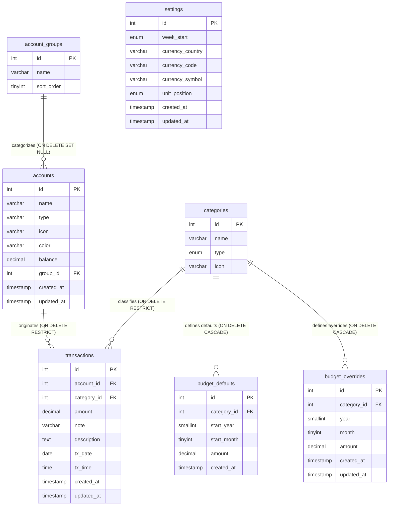

# Database Schema Documentation: `ledgr` Database

This document details the relational schema, entity relationships, integrity constraints, and cardinality rules for the MySQL database powering the **Ledgr** budget tracker application. It serves as formal documentation for our college Database Systems (DBS) project.

---

## 1. Database Specifications and Configuration

* **Database Name**: `ledgr`
* **RDBMS Engine**: MySQL 8.4 (InnoDB Storage Engine)
* **Default Character Set**: `utf8mb4`
* **Default Collation**: `utf8mb4_unicode_ci`
* **Container Name**: `ledgr_mysql`
* **Port Mapping**: `3306:3306`
* **Connection Attributes**:
  * Default user: `ledgr`
  * Root password: `root_password`
  * Timezone: `+00:00` (UTC)
  * Node.js client driver: `mysql2/promise` with connection pooling (Limit: 10)

---

## 2. Formal Relational Schema Notation

The database consists of **7 relations**. Underlined attributes indicate **Primary Keys (PK)**; asterisked attributes (`*`) indicate **Foreign Keys (FK)**.

1. **`settings`** (
   <u>`id`</u>, `week_start`, `currency_country`, `currency_code`, `currency_symbol`, `unit_position`, `created_at`, `updated_at`
   )
2. **`account_groups`** (
   <u>`id`</u>, `name`, `sort_order`
   )
3. **`accounts`** (
   <u>`id`</u>, `name`, `type`, `icon`, `color`, `balance`, `group_id`*, `created_at`, `updated_at`
   )
4. **`categories`** (
   <u>`id`</u>, `name`, `type`, `icon`
   )
5. **`budget_defaults`** (
   <u>`id`</u>, `category_id`*, `start_year`, `start_month`, `amount`, `created_at`
   )
6. **`budget_overrides`** (
   <u>`id`</u>, `category_id`*, `year`, `month`, `amount`, `created_at`, `updated_at`
   )
7. **`transactions`** (
   <u>`id`</u>, `account_id`*, `category_id`*, `amount`, `note`, `description`, `tx_date`, `tx_time`, `created_at`, `updated_at`
   )

---

## 3. Entity-Relationship (ER) Diagram

The following Crow's Foot ER Diagram represents the actual seven-table database structure, showing entity attributes, primary keys, foreign keys, and relationship cardinalities.

---

## 4. Comprehensive Table Specifications

### 4.1. `settings`
Stores singleton global configuration settings and localized currency display preferences.

| Column | Data Type | Nullable | Default | Constraints | Description |
| :--- | :--- | :--- | :--- | :--- | :--- |
| `id` | `INT UNSIGNED` | No | Auto Increment | `PRIMARY KEY` | Setting identifier (singleton row `id=1`) |
| `week_start` | `ENUM('Sunday', 'Monday', 'Tuesday', 'Wednesday', 'Thursday', 'Friday', 'Saturday')` | No | `'Sunday'` | Domain ENUM | Starting day for weekly and calendar views |
| `currency_country` | `VARCHAR(100)` | No | `'Malaysia'` | Domain | Country name for currency formatting |
| `currency_code` | `VARCHAR(10)` | No | `'MYR'` | Domain | ISO 4217 Currency Code |
| `currency_symbol` | `VARCHAR(10)` | No | `'RM'` | Domain | Display currency symbol |
| `unit_position` | `ENUM('prefix', 'suffix')` | No | `'prefix'` | Domain ENUM | Currency symbol placement |
| `created_at` | `TIMESTAMP` | Yes | `CURRENT_TIMESTAMP` | Default | Record creation timestamp |
| `updated_at` | `TIMESTAMP` | Yes | `CURRENT_TIMESTAMP ON UPDATE CURRENT_TIMESTAMP` | Action | Record update timestamp |

---

### 4.2. `account_groups`
Classifies accounts into logical banking and financial groupings (e.g., Cash, Bank, Card, E-wallet).

| Column | Data Type | Nullable | Default | Constraints | Description |
| :--- | :--- | :--- | :--- | :--- | :--- |
| `id` | `INT UNSIGNED` | No | Auto Increment | `PRIMARY KEY` | Unique group identifier |
| `name` | `VARCHAR(50)` | No | *None* | Domain | Name of account group |
| `sort_order` | `TINYINT UNSIGNED` | No | `0` | `sort_order >= 0` | Display sorting priority |

---

### 4.3. `accounts`
Stores individual liquid assets, liabilities, and bank accounts with real-time balance tracking.

| Column | Data Type | Nullable | Default | Constraints | Description |
| :--- | :--- | :--- | :--- | :--- | :--- |
| `id` | `INT UNSIGNED` | No | Auto Increment | `PRIMARY KEY` | Unique account identifier |
| `name` | `VARCHAR(100)` | No | *None* | Domain | Account display name |
| `type` | `VARCHAR(50)` | No | *None* | Domain | Type descriptor (e.g. 'Savings account') |
| `icon` | `VARCHAR(50)` | No | `'wallet'` | Domain | Lucide icon identifier |
| `color` | `VARCHAR(20)` | No | `'#7b5cf0'` | Domain | Hex color code for UI rendering |
| `balance` | `DECIMAL(15,2)` | No | `0.00` | Fixed point (15,2) | Current balance (derived/cached) |
| `group_id` | `INT UNSIGNED` | Yes | `NULL` | `FOREIGN KEY` | Ref: `account_groups(id)` (`ON DELETE SET NULL`) |
| `created_at` | `TIMESTAMP` | Yes | `CURRENT_TIMESTAMP` | Default | Record creation timestamp |
| `updated_at` | `TIMESTAMP` | Yes | `CURRENT_TIMESTAMP ON UPDATE CURRENT_TIMESTAMP` | Action | Record update timestamp |

---

### 4.4. `categories`
Stores classification labels for income sources and expense targets.

| Column | Data Type | Nullable | Default | Constraints | Description |
| :--- | :--- | :--- | :--- | :--- | :--- |
| `id` | `INT UNSIGNED` | No | Auto Increment | `PRIMARY KEY` | Unique category identifier |
| `name` | `VARCHAR(100)` | No | *None* | Domain | Category display name |
| `type` | `ENUM('income', 'expense')` | No | *None* | Domain ENUM | Transaction flow direction |
| `icon` | `VARCHAR(50)` | No | `'tag'` | Domain | Lucide icon identifier |

* **Unique Key Constraint**:
  * `uq_name_type UNIQUE KEY (name, type)`: Prevents duplicate category names within the same flow direction (e.g., an 'Investment' expense and 'Investment' income are permitted, but two 'Salary' incomes are prohibited).

---

### 4.5. `budget_defaults`
Stores time-series baseline monthly spending limits for expense categories. Defaults are valid until a newer default entry is recorded for a later month.

| Column | Data Type | Nullable | Default | Constraints | Description |
| :--- | :--- | :--- | :--- | :--- | :--- |
| `id` | `INT UNSIGNED` | No | Auto Increment | `PRIMARY KEY` | Default limit identifier |
| `category_id` | `INT UNSIGNED` | No | *None* | `FOREIGN KEY` | Ref: `categories(id)` (`ON DELETE CASCADE`) |
| `start_year` | `SMALLINT UNSIGNED` | No | *None* | Temporal | Effective starting year |
| `start_month` | `TINYINT UNSIGNED` | No | *None* | 1–12 | Effective starting month (1-indexed) |
| `amount` | `DECIMAL(15,2)` | No | *None* | `amount >= 0` | Monthly budget limit |
| `created_at` | `TIMESTAMP` | Yes | `CURRENT_TIMESTAMP` | Default | Record creation timestamp |

* **Unique Key Constraint**:
  * `uq_cat_start UNIQUE KEY (category_id, start_year, start_month)`: Enforces at most one baseline limit per category starting at a given year and month.

---

### 4.6. `budget_overrides`
Stores month-specific budget overrides that supersede the effective default for a specific month only.

| Column | Data Type | Nullable | Default | Constraints | Description |
| :--- | :--- | :--- | :--- | :--- | :--- |
| `id` | `INT UNSIGNED` | No | Auto Increment | `PRIMARY KEY` | Override identifier |
| `category_id` | `INT UNSIGNED` | No | *None* | `FOREIGN KEY` | Ref: `categories(id)` (`ON DELETE CASCADE`) |
| `year` | `SMALLINT UNSIGNED` | No | *None* | Temporal | Specific year of override |
| `month` | `TINYINT UNSIGNED` | No | *None* | 1–12 | Specific month of override (1-indexed) |
| `amount` | `DECIMAL(15,2)` | No | *None* | `amount >= 0` | Overriding budget limit |
| `created_at` | `TIMESTAMP` | Yes | `CURRENT_TIMESTAMP` | Default | Record creation timestamp |
| `updated_at` | `TIMESTAMP` | Yes | `CURRENT_TIMESTAMP ON UPDATE CURRENT_TIMESTAMP` | Action | Record update timestamp |

* **Unique Key Constraint**:
  * `uq_cat_ym UNIQUE KEY (category_id, year, month)`: Enforces exactly one override per category for any single calendar month.

---

### 4.7. `transactions`
Records financial transactions, debit/credit values, dates, and account/category linkages.

| Column | Data Type | Nullable | Default | Constraints | Description |
| :--- | :--- | :--- | :--- | :--- | :--- |
| `id` | `INT UNSIGNED` | No | Auto Increment | `PRIMARY KEY` | Unique transaction identifier |
| `account_id` | `INT UNSIGNED` | No | *None* | `FOREIGN KEY` | Ref: `accounts(id)` (`ON DELETE RESTRICT`) |
| `category_id` | `INT UNSIGNED` | No | *None* | `FOREIGN KEY` | Ref: `categories(id)` (`ON DELETE RESTRICT`) |
| `amount` | `DECIMAL(15,2)` | No | *None* | Domain | Signed amount (positive = income, negative = expense) |
| `note` | `VARCHAR(255)` | No | `''` | Domain | Short transaction summary |
| `description` | `TEXT` | Yes | `NULL` | Domain | Detailed notes, JSON metadata, or tags |
| `tx_date` | `DATE` | No | *None* | Temporal | Date of transaction (`YYYY-MM-DD`) |
| `tx_time` | `TIME` | No | `'00:00:00'` | Temporal | Time of transaction (`HH:MM:SS`) |
| `created_at` | `TIMESTAMP` | Yes | `CURRENT_TIMESTAMP` | Default | Record creation timestamp |
| `updated_at` | `TIMESTAMP` | Yes | `CURRENT_TIMESTAMP ON UPDATE CURRENT_TIMESTAMP` | Action | Record update timestamp |

---

## 5. Primary Keys, Foreign Keys, and Referential Integrity

| Table | Constraint Name | Type | Column(s) | Referenced Table & Column | Referential Action |
| :--- | :--- | :--- | :--- | :--- | :--- |
| `settings` | `PRIMARY` | Primary Key | `id` | — | — |
| `account_groups` | `PRIMARY` | Primary Key | `id` | — | — |
| `accounts` | `PRIMARY` | Primary Key | `id` | — | — |
| `accounts` | `fk_acc_group` | Foreign Key | `group_id` | `account_groups(id)` | `ON DELETE SET NULL` `ON UPDATE NO ACTION` |
| `categories` | `PRIMARY` | Primary Key | `id` | — | — |
| `categories` | `uq_name_type` | Unique Key | `(name, type)` | — | — |
| `budget_defaults` | `PRIMARY` | Primary Key | `id` | — | — |
| `budget_defaults` | `uq_cat_start` | Unique Key | `(category_id, start_year, start_month)` | — | — |
| `budget_defaults` | `fk_bdef_cat` | Foreign Key | `category_id` | `categories(id)` | `ON DELETE CASCADE` `ON UPDATE NO ACTION` |
| `budget_overrides` | `PRIMARY` | Primary Key | `id` | — | — |
| `budget_overrides` | `uq_cat_ym` | Unique Key | `(category_id, year, month)` | — | — |
| `budget_overrides` | `fk_bover_cat`| Foreign Key | `category_id` | `categories(id)` | `ON DELETE CASCADE` `ON UPDATE NO ACTION` |
| `transactions` | `PRIMARY` | Primary Key | `id` | — | — |
| `transactions` | `fk_tx_account`| Foreign Key | `account_id` | `accounts(id)` | `ON DELETE RESTRICT` `ON UPDATE NO ACTION` |
| `transactions` | `fk_tx_category`| Foreign Key | `category_id` | `categories(id)` | `ON DELETE RESTRICT` `ON UPDATE NO ACTION` |

### Architectural Rationale for Referential Actions:
1. **`ON DELETE SET NULL` on `accounts.group_id`**: If an account group is dissolved (e.g., removing 'E-wallet'), the underlying account records are preserved as unclassified rather than destroyed.
2. **`ON DELETE CASCADE` on `budget_defaults` and `budget_overrides`**: Budgets only have meaning relative to an existing expense category. Deleting a category automatically purges its associated budget limits, avoiding orphaned limit records.
3. **`ON DELETE RESTRICT` on `transactions.account_id` and `transactions.category_id`**: Financial audit trails must remain immutable. Deleting an account or category that is referenced by historical ledger transactions is strictly forbidden by the DBMS engine to guarantee financial integrity.

---

## 6. Relationship Cardinality and Participation Rules

| Relationship | Cardinality Ratio | Account/Category Participation | Related Table Participation | Explanation |
| :--- | :--- | :--- | :--- | :--- |
| `account_groups` $\rightarrow$ `accounts` | $1 : N$ ($1$ to $0..\infty$) | Total (a group has 0 or more accounts) | Partial (an account may have `group_id = NULL`) | An account can exist without an assigned group. |
| `accounts` $\rightarrow$ `transactions` | $1 : N$ ($1$ to $0..\infty$) | Partial (an account can have 0 transactions) | Total (a transaction MUST link to exactly 1 account) | Every transaction originates from an account; an account can be newly created with zero activity. |
| `categories` $\rightarrow$ `transactions` | $1 : N$ ($1$ to $0..\infty$) | Partial (a category can have 0 transactions) | Total (a transaction MUST link to exactly 1 category) | Every transaction has a category; a category can exist without prior transactions. |
| `categories` $\rightarrow$ `budget_defaults` | $1 : N$ ($1$ to $0..\infty$) | Partial (income categories and unbudgeted expense categories have 0 defaults) | Total (a default budget MUST reference an existing category) | Only expense categories utilize budget defaults. |
| `categories` $\rightarrow$ `budget_overrides` | $1 : N$ ($1$ to $0..\infty$) | Partial (most months and categories have 0 overrides) | Total (an override MUST reference an existing category) | Overrides are created strictly as exceptions. |
| `settings` | Singleton ($1:1$) | Total | Total | Standalone configuration table with exactly one active record (`id = 1`). |
