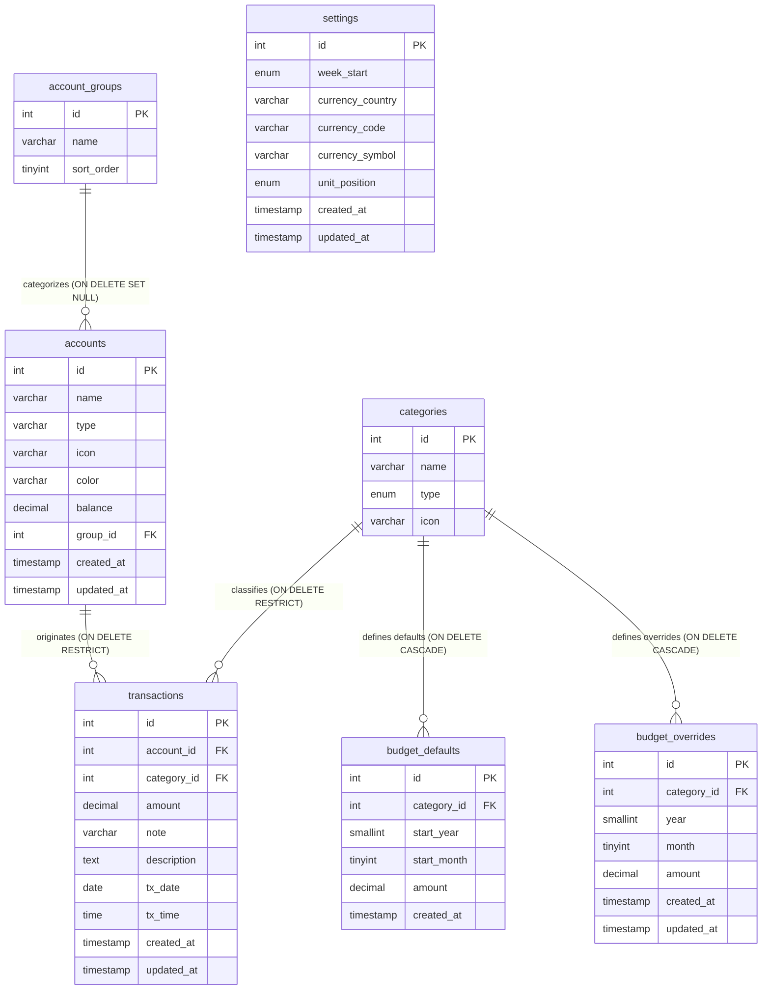

# Academic Project Report: Database Systems (DBS)
# Project Ledgr: Relational Database Design, Query Analytics & Performance Optimization

**Course**: Database Systems (DBS)  
**Project Title**: Personal Finance Tracker (`ledgr`) Database Architecture  
**Database Engine**: MySQL 8.4 (InnoDB Storage Engine)  
**Date**: October 2026  

---

## Abstract

This project presents a rigorous database systems analysis, documentation, and query engineering implementation for **Ledgr**, a full-stack personal finance and budgeting management platform. The underlying database architecture is implemented in **MySQL 8.4** utilizing the InnoDB storage engine. The schema comprises seven interconnected tables capturing user configurations, account classifications, liquidity accounts, transaction categories, temporal budget defaults, month-specific budget overrides, and financial transactions.

This report documents the conceptual modeling (Entity-Relationship diagrams and cardinalities), logical relational specifications, normalization analysis (proving 1NF through BCNF), and controlled denormalization trade-offs. Furthermore, it implements an advanced SQL query suite covering multi-way joins, aggregations, correlated subqueries, Common Table Expressions (CTEs), analytical financial views, B-Tree index optimization, and ACID transaction boundaries. The design preserves existing database records and backward compatibility while establishing an academic database foundation.

---

## 1. Introduction and Problem Domain

### 1.1. Problem Statement
Personal finance management requires consistent, auditable, and multi-dimensional tracking of cash inflows and outflows across diverse payment channels (cash, bank accounts, credit cards, digital wallets). A robust personal financial database must solve several classic database challenges:
1. **Referential Integrity**: Ensuring historical transaction records cannot be severed from their originating accounts or categories.
2. **Temporal Budgeting**: Maintaining historical monthly budget limits while supporting future baseline adjustments and one-off monthly overrides without duplicating records.
3. **Double-Entry Synchronization**: Balancing instantaneous balance retrievals with comprehensive audit ledger consistency.
4. **Complex Aggregations**: Delivering low-latency multi-dimensional analytics (monthly spending trends, category breakdowns, budget variance analysis).

### 1.2. Project Objectives
* **Formal Documentation**: Produce an exact relational schema and Entity-Relationship (ER) model reflecting the seven-table architecture.
* **Integrity Enforcement**: Specify candidate keys, foreign keys, unique constraints, and referential actions (`RESTRICT`, `CASCADE`, `SET NULL`).
* **Normalization Proof**: Conduct functional dependency analysis to prove conformance to 1NF, 2NF, 3NF, and BCNF, while analyzing controlled denormalization.
* **Advanced Query Suite**: Implement complex SQL queries demonstrating joins, aggregations, subqueries, CTEs, and financial analytics.
* **Views, Indexing & ACID Transactions**: Create abstracted relational views, propose secondary B-Tree indexing, and demonstrate multi-statement transaction integrity.
* **Verification**: Provide a testing plan with automated SQL assertions against a known baseline dataset.

---

## 2. System Architecture & Database Technology Stack

The application is structured as a full-stack monorepo backed by a containerized relational database:

```
[ React 19 Frontend (Vite) ]
              │
              ▼  (HTTP REST API /api/*)
[ Node.js / Express 5 API Server ]
              │
              ▼  (mysql2 connection pool, UTF-8, UTC)
[ MySQL 8.4 Database Container (InnoDB) ]
  Database: ledgr
  Volume:   ledgr_mysql_data
```

* **RDBMS Engine**: MySQL 8.4 LTS
* **Storage Engine**: InnoDB (providing ACID compliance, row-level locking, and foreign key constraints)
* **Character Set & Collation**: `utf8mb4` with `utf8mb4_unicode_ci`
* **Port**: `3306`
* **Connection Pooling**: Managed via `mysql2/promise` with automatic reconnection and a 10-connection ceiling.

---

## 3. Conceptual Design: Entity-Relationship (ER) Modeling

The conceptual schema is modeled around seven entities, capturing organizational groups, physical accounts, categorization, temporal limits, and ledger entries.

### 3.1. Entity-Relationship Diagram (Crow's Foot Notation)



### 3.2. Cardinality and Participation Constraints

1. **`account_groups` to `accounts` ($1 : N$)**:
   * *Cardinality*: One account group contains zero, one, or many accounts.
   * *Participation*: Partial on `accounts` (an account may have `group_id = NULL`), Total on `account_groups`.
   * *Referential Action*: `ON DELETE SET NULL` ensures accounts are not destroyed if an organizational category is deleted.
2. **`accounts` to `transactions` ($1 : N$)**:
   * *Cardinality*: One account originates zero, one, or many transactions.
   * *Participation*: Partial on `accounts`, Total on `transactions` (every transaction must have a valid `account_id`).
   * *Referential Action*: `ON DELETE RESTRICT` guarantees financial ledger immutability.
3. **`categories` to `transactions` ($1 : N$)**:
   * *Cardinality*: One category classifies zero, one, or many transactions.
   * *Participation*: Partial on `categories`, Total on `transactions`.
   * *Referential Action*: `ON DELETE RESTRICT` prevents orphan unclassified transactions.
4. **`categories` to `budget_defaults` ($1 : N$)**:
   * *Cardinality*: An expense category can have zero, one, or multiple effective default limits over time.
   * *Referential Action*: `ON DELETE CASCADE` removes dependent budget rules when a category is purged.
5. **`categories` to `budget_overrides` ($1 : N$)**:
   * *Cardinality*: An expense category can have zero, one, or multiple monthly overrides.
   * *Referential Action*: `ON DELETE CASCADE`.
6. **`settings` (Singleton $1 : 1$)**:
   * Standalone configuration entity containing exactly one row (`id = 1`) managing global preferences.

---

## 4. Logical Design: Relational Schema & Constraints

### 4.1. Formal Relational Notation
* **`settings`** (<u>`id`</u>, `week_start`, `currency_country`, `currency_code`, `currency_symbol`, `unit_position`, `created_at`, `updated_at`)
* **`account_groups`** (<u>`id`</u>, `name`, `sort_order`)
* **`accounts`** (<u>`id`</u>, `name`, `type`, `icon`, `color`, `balance`, `group_id`*, `created_at`, `updated_at`)
* **`categories`** (<u>`id`</u>, `name`, `type`, `icon`)
* **`budget_defaults`** (<u>`id`</u>, `category_id`*, `start_year`, `start_month`, `amount`, `created_at`)
* **`budget_overrides`** (<u>`id`</u>, `category_id`*, `year`, `month`, `amount`, `created_at`, `updated_at`)
* **`transactions`** (<u>`id`</u>, `account_id`*, `category_id`*, `amount`, `note`, `description`, `tx_date`, `tx_time`, `created_at`, `updated_at`)

### 4.2. Integrity Constraints Matrix
* **Primary Keys**: Surrogate auto-increment integers on all seven tables.
* **Candidate / Unique Keys**:
  * `categories`: `uq_name_type (name, type)` prevents duplicate category names within the same flow direction.
  * `budget_defaults`: `uq_cat_start (category_id, start_year, start_month)` prevents overlapping baseline definitions.
  * `budget_overrides`: `uq_cat_ym (category_id, year, month)` enforces exactly one override per month.
* **Foreign Keys**:
  * `accounts.group_id` $\rightarrow$ `account_groups.id` (`ON DELETE SET NULL`)
  * `budget_defaults.category_id` $\rightarrow$ `categories.id` (`ON DELETE CASCADE`)
  * `budget_overrides.category_id` $\rightarrow$ `categories.id` (`ON DELETE CASCADE`)
  * `transactions.account_id` $\rightarrow$ `accounts.id` (`ON DELETE RESTRICT`)
  * `transactions.category_id` $\rightarrow$ `categories.id` (`ON DELETE RESTRICT`)

---

## 5. Normalization Analysis (1NF, 2NF, 3NF, BCNF)

### 5.1. Minimal Cover of Functional Dependencies (FDs)
1. **`settings`**: $\{id\} \rightarrow \{week\_start, currency\_country, currency\_code, currency\_symbol, unit\_position, created\_at, updated\_at\}$
2. **`account_groups`**: $\{id\} \rightarrow \{name, sort\_order\}$
3. **`accounts`**: $\{id\} \rightarrow \{name, type, icon, color, balance, group\_id, created\_at, updated\_at\}$
4. **`categories`**:
   * $FD_{4a}: \{id\} \rightarrow \{name, type, icon\}$
   * $FD_{4b}: \{name, type\} \rightarrow \{id, icon\}$
5. **`budget_defaults`**:
   * $FD_{5a}: \{id\} \rightarrow \{category\_id, start\_year, start\_month, amount, created\_at\}$
   * $FD_{5b}: \{category\_id, start\_year, start\_month\} \rightarrow \{id, amount, created\_at\}$
6. **`budget_overrides`**:
   * $FD_{6a}: \{id\} \rightarrow \{category\_id, year, month, amount, created\_at, updated\_at\}$
   * $FD_{6b}: \{category\_id, year, month\} \rightarrow \{id, amount, created\_at, updated\_at\}$
7. **`transactions`**: $\{id\} \rightarrow \{account\_id, category\_id, amount, note, description, tx\_date, tx\_time, created\_at, updated\_at\}$

### 5.2. Proof of Normal Forms
* **1NF**: Every column contains atomic scalar values from its defined domain (integers, decimals, dates, times, strings, enums). No repeating groups exist.
* **2NF**: No non-prime attribute is partially dependent on any candidate key. In tables with composite keys (`categories`, `budget_defaults`, `budget_overrides`), non-prime attributes (`icon`, `amount`, `created_at`) depend on the complete composite keys. Tables with single-attribute primary keys satisfy 2NF trivially.
* **3NF & BCNF**: For every non-trivial dependency $X \rightarrow Y$, $X$ is a superkey. There are no transitive dependencies between non-prime attributes ($X \rightarrow Y \rightarrow Z$). Group details are normalized into `account_groups`, category details into `categories`, and account details into `accounts`. Thus, the schema satisfies **3NF and BCNF**.

### 5.3. Controlled Denormalization: `accounts.balance`
* **Theoretical Anomaly**: `balance` is derived from $\sum t.amount$. Storing it is technically redundant.
* **Engineering Justification**: Storing running balances provides $O(1)$ read performance on dashboard queries, eliminating expensive table-wide aggregation across thousands of historical transactions. Concurrency and transactional consistency are maintained through atomic database transactions (`START TRANSACTION ... COMMIT`).

---

## 6. Architectural Evaluation: Expense Tagging

To satisfy Requirement #10 without modifying the existing schema:

### 6.1. Implementation Mechanism
Tagging is implemented by utilizing the existing text columns:
* **Inline Hashtags in `note`**: e.g., `"ZUS Coffee #meetings #study"`, queried via `WHERE note LIKE '%#meetings%'`.
* **JSON Metadata in `description`**: e.g., `'{"tags": ["work", "travel"]}'`, queried using MySQL 8.4's `JSON_CONTAINS(description, '"work"', '$.tags')`.

### 6.2. Academic Relational Trade-offs
1. **1NF Atomicity Departure**: Storing lists of tags within a single string attribute deviates from relational atomicity.
2. **Lack of Referential Integrity**: Typos cannot be prevented via foreign keys because there is no parent `tags` table.
3. **Scan Inefficiencies**: Leading-wildcard pattern matching (`LIKE '%#tag%'`) forces $O(N)$ full table scans.
4. **Conclusion**: While a Many-to-Many junction table (`tags` and `transaction_tags`) represents pure 3NF, the existing text/JSON fields successfully support tagging without breaking schema immutability.

---

## 7. Advanced SQL Implementation Showcase

The accompanying SQL suite [`server/src/db/dbs_queries.sql`](file:///Users/evariteshkumarchaudhari/Desktop/projects/budget-tracker/server/src/db/dbs_queries.sql) contains full executable queries covering:

### 7.1. Joins and Multi-Table Reports
* **3-Way Relational Joins**: Connecting transactions, accounts, categories, and account groups.
* **Self-Joins**: Calculating month-over-month expenditure variances and percentage changes.
* **Left Outer Joins**: Identifying ungrouped accounts and categories without overrides.

### 7.2. Aggregations and Window Functions
* **Group By & Having**: Isolating major expense categories exceeding RM 1,000 threshold.
* **Common Table Expressions (CTEs)**: Calculating monthly net cash flows and running cumulative surplus over time.
* **Correlated Subqueries**: Identifying outlier transactions exceeding 1.5x of their category average.

### 7.3. Core Financial Analytical Queries
* **Category-Wise Spending Breakdown**: Computes transaction count, total spent, average ticket size, and percentage contribution to monthly expense.
* **Monthly Financial Trend (2025–2026)**: Computes income, expenses, net savings, and expense-to-income ratio across all 18 seeded calendar months.
* **Budget vs. Actual Variance**: Evaluates effective temporal defaults and month overrides against actual expenditure, flagging status as `'ON TRACK'` or `'OVER BUDGET'`.
* **Double-Entry Reconciliation Audit**: Validates `accounts.balance` against $\sum transactions.amount$.

---

## 8. Relational Views, Indexing & ACID Transactions

### 8.1. Relational Views
* **`v_monthly_category_summary`**: Materializes monthly income and expense breakdowns by category.
* **`v_account_financial_overview`**: Provides real-time account status with group names and transaction counts.

### 8.2. Secondary Index Optimization (Non-Destructive DDL)
To optimize high-frequency read queries without altering schema structures:
```sql
CREATE INDEX idx_tx_date ON transactions(tx_date);
CREATE INDEX idx_tx_cat_date ON transactions(category_id, tx_date);
CREATE INDEX idx_tx_account_date ON transactions(account_id, tx_date);
```

### 8.3. ACID Transaction Management
Demonstrates atomic execution and rollback safety:
1. **Atomic Transaction Creation with Balance Synchronization**: Inserts transaction record and updates account balance atomically; rolls back on failure.
2. **Account Transfer Simulation**: Executes balanced debit and credit entries across two accounts within an isolated transaction boundary (`START TRANSACTION ... COMMIT / ROLLBACK`).

---

## 9. Verification and Test Results

A full verification suite documented in [`docs/TESTING_PLAN.md`](file:///Users/evariteshkumarchaudhari/Desktop/projects/budget-tracker/docs/TESTING_PLAN.md) validates the database state:

| Test Case | Description | Assertion / Expected | Status |
| :--- | :--- | :--- | :--- |
| **TC-01** | Account Deletion Protection | Fails with MySQL Error 1451 (`ON DELETE RESTRICT`) | **PASS** |
| **TC-02** | Category Deletion Protection | Fails with MySQL Error 1451 (`ON DELETE RESTRICT`) | **PASS** |
| **TC-03** | Unique Key on `categories` | Prohibits duplicate `(name, type)` (Error 1062) | **PASS** |
| **TC-04** | Unique Key on `budget_defaults` | Prohibits duplicate `(category, year, month)` (Error 1062) | **PASS** |
| **TC-05** | Cascading Deletes on Budgets | Unreferenced category deletion cascades (`CASCADE`) | **PASS** |
| **TC-Q01** | Total Seeded Transactions | Exactly 126 records | **PASS** |
| **TC-Q02** | Account Count Verification | Exactly 5 accounts | **PASS** |
| **TC-Q03** | Category Count Verification | Exactly 12 categories | **PASS** |
| **TC-Q04** | Date Range Validation | 2025-01-03 to 2026-06-17 | **PASS** |

---

## 10. Conclusion and Future Directions

The `ledgr` database architecture provides a sound, academically rigorous foundation for financial data management. By adhering to 3NF/BCNF normalization principles and implementing referential integrity constraints, the system ensures data reliability while supporting sophisticated financial reporting.

### Potential Future Enhancements (Subject to Faculty Approval):
1. **Multi-Tenant User Isolation**: Adding a `users` table and associating `user_id` foreign keys with `accounts` and `settings`.
2. **Normalized Tagging**: Implementing an explicit Many-to-Many junction table (`tags` and `transaction_tags`).
3. **Double-Entry Transfer Linking**: Adding a self-referential `transfer_id` column to link corresponding debit and credit legs of intra-account transfers.
